<h1 align="center">Training Provenance</h1>

<p align="center">
  <em>Content-addressed provenance tracking for machine learning pipelines: a deduplicating artifact store, a content-addressed lineage DAG, and bit-for-bit reproducibility and integrity verification, all dependency-free.</em>
</p>

<p align="center">
  <a href="https://github.com/adeoluo/training-provenance/actions/workflows/ci.yml"></a>
  
  
  
  
  
</p>

---

## Motivation

A trained model is only trustworthy if you can say exactly what produced it: which dataset, which
configuration, which code, and whether the whole thing reproduces. That is the problem of
**training provenance**, and it is the backbone of reproducible research, model audits, and
incident response. This project implements a provenance system **from scratch**:
artifacts are **content-addressed** so their identity is their hash, runs are recorded in a
**lineage DAG** that is itself content-addressed, and the entire pipeline can be **re-executed
and verified** bit for bit, with byte-level integrity checks that catch tampering. It has **zero
runtime dependencies** and uses only the standard library.

## Architecture

<p align="center">
  
</p>

Every artifact is stored under the hash of its canonical bytes, so identical content is stored
once and any change yields a new identifier. Every run records its inputs, parameters, code
version, and outputs, and is keyed by the hash of those inputs. See the [ADRs](docs/adr/) for the
key decisions.

## The ideas

- **Content addressing.** An artifact's identifier is `sha256` over its canonical serialization.
  Identical content always hashes the same, so deduplication is automatic and any change,
  however small, is visible as a different identifier.
- **A content-addressed lineage DAG.** A run records that an operation consumed an ordered list
  of input artifacts under a declared code version and produced output artifacts. The run's own
  identity is the hash of its inputs, so the same operation on the same inputs is the same run.
  Traversing the edges recovers the full provenance of any artifact.
- **Reproducibility and integrity verification.** Because transforms are deterministic, a run can
  be re-executed and its output identifiers compared to what was recorded. A whole pipeline is
  verified by walking a target's lineage, re-executing every run, and checking that every stored
  artifact still hashes to its identifier.

## Results

> Reproduce with `python -m training_provenance build` and `python -m training_provenance verify`.
> The tracked pipeline standardizes a dataset, fits a ridge-regression model, and evaluates it.

| Property | Result |
|---|---|
| **pipeline reproduces bit for bit** | **yes (3 of 3 runs, full integrity)** |
| deterministic rebuild (same metrics identifier) | yes |
| deduplication (re-storing content is a no-op) | yes |
| tamper detection (corrupt an artifact) | caught, verification fails, run pinpointed |
| model fit (held-in R squared) | 0.999 |

The pipeline is **reproducible and deterministic**: rebuilding from the same inputs yields the
same content identifier for every artifact, down to the evaluation metrics. Corrupting any
tracked artifact is detected by the integrity check, and the run whose output no longer matches
is pinpointed.

### Scale

`benchmarks/scale.py` builds and verifies the tracked standardize -> train_ridge -> evaluate
pipeline over progressively larger synthetic datasets and reports wall-clock time, throughput in
rows ingested per second, peak traced memory (`tracemalloc`), the fraction of the lineage that
verifies, and the held-in R squared. Content hashing and ingestion scale linearly with the
dataset, every lineage verifies bit for bit, and the model fit holds.

| dataset rows | seconds | rows/sec | peak MiB | lineage verified | held-in R² |
|---:|---:|---:|---:|---:|---:|
| 1,000 | 0.13 | 7,600 | 0.67 | 1.000 | 0.9991 |
| 4,000 | 0.54 | 7,400 | 2.63 | 1.000 | 0.9991 |
| 16,000 | 2.58 | 6,200 | 10.55 | 1.000 | 0.9992 |

Honest caveat: the data is synthetic, this is a pure-Python from-scratch implementation, and it
is **not** benchmarked against compiled numerical libraries; wall-clock and throughput were
measured on a shared development machine and will vary. Reproduce with
`uv run python benchmarks/scale.py`.

## Demonstration

```text
$ python -m training_provenance build
Tracked pipeline:
  artifacts 5  runs 3  reproduced (100% of runs)  integrity failures 0  metrics {'mse': ..., 'r2': 0.9991}
Lineage of the evaluation metrics (roots first):
  standardize   [4499360d5a24] -> [a1b2c3d4e5f6]  run 7f8e9d0c1b2a
  train_ridge   [a1b2c3d4e5f6, 45ce830bc5d6] -> [...]  run ...
  evaluate      [..., a1b2c3d4e5f6] -> [...]  run ...

$ python -m training_provenance tamper
Corrupting standardized dataset artifact ... 
Reproducible after tamper: False
Integrity failures detected: 1
  standardize   MISMATCH
```

## Quickstart

```bash
git clone https://github.com/adeoluo/training-provenance.git && cd training-provenance
make setup                    # install dev tooling + pre-commit hooks
make all                      # lint + type-check + test

python -m training_provenance build      # run the tracked pipeline and print the lineage
python -m training_provenance verify     # verify it reproduces bit for bit
python -m training_provenance tamper     # corrupt an artifact and watch detection fire
```

Track your own pipeline:

```python
from training_provenance import ContentStore, Ledger, Kind, execute, verify_lineage

store, ledger = ContentStore(), Ledger()
raw = store.put({"features": [[1.0]], "labels": [2.0]}, Kind.DATASET)
(std,) = execute(store, ledger, "standardize", [raw.id], [Kind.DATASET])
print(verify_lineage(store, ledger, std).reproduced)
```

## Running the service

A dependency-free HTTP service builds the tracked pipeline once at startup and serves provenance
queries:

```bash
python -m training_provenance serve --port 8000

curl localhost:8000/health
curl localhost:8000/report
curl localhost:8000/verify
curl -s -X POST localhost:8000/lineage -d '{"artifact": "sha256:..."}'
```

See the [operations guide](docs/OPERATIONS.md) for the service contract and constraints. The
service also exposes `GET /ready` (readiness) and `GET /metrics` (per-route request, error, and
latency metrics in Prometheus text format). A production-style stress benchmark
(`uv run python benchmarks/stress.py`) reports throughput and p50/p95/p99 latency; the scaling
path and tradeoffs are in [docs/SCALING.md](docs/SCALING.md) and a full walk-through is in the
[case study](docs/CASE_STUDY.md).

## Components

- **hashing** - canonical serialization and content identifiers.
- **store** - a deduplicating, content-addressed artifact store with integrity checks.
- **transforms** - a registry of deterministic transforms and the demonstration pipeline steps.
- **provenance** - runs and the content-addressed lineage DAG with ancestor traversal.
- **reproduce** - execution, single-run verification, and whole-lineage verification.
- **pipeline** - the tracked standardize, train, evaluate pipeline.
- **evaluation** - a summary report over a tracked pipeline.

## Design decisions

- **Content addressing over counters.** Identifiers are hashes of content, which gives
  deduplication, tamper evidence, and reproducible identity for free.
  ([ADR-0002](docs/adr/0002-content-addressing.md))
- **Verification by re-execution.** Determinism plus content addressing means reproducibility is
  checkable, not asserted, and failures are localized to a run.
  ([ADR-0003](docs/adr/0003-verification-by-reexecution.md))

## Responsible AI

- **Model card:** [docs/MODEL_CARD.md](docs/MODEL_CARD.md)
- **Data card:** [docs/DATA_CARD.md](docs/DATA_CARD.md)
- **Threat model:** [docs/THREAT_MODEL.md](docs/THREAT_MODEL.md)

## Limitations

- Verification by re-execution requires deterministic transforms. Nondeterministic steps (unseeded
  randomness, concurrency, floating-point reductions in varying order) would need their
  nondeterminism captured or pinned before they can be verified this way.
- Artifacts are stored in memory and serialized as JSON, which suits tractable pipelines rather
  than terabyte checkpoints; a real deployment would back the store with a blob store.
- The demonstration transforms are small by design; the tracking machinery is the contribution.

## Roadmap

- [ ] A pluggable blob backend for large artifacts with the same content addresses
- [ ] Merkle proofs for partial lineage verification without the full store
- [ ] Capture of environment and code hashes as first-class lineage inputs

## License

[MIT](LICENSE). Part of an artificial intelligence engineering portfolio by
[adeoluo](https://github.com/adeoluo).
