<h1 align="center">Training Provenance</h1>

<p align="center">
  <em>Content-addressed provenance tracking for machine learning pipelines: a deduplicating artifact store, a content-addressed lineage DAG, and bit-for-bit reproducibility and integrity verification.</em>
</p>

<p align="center">
  <a href="https://github.com/adeoluo/training-provenance/actions/workflows/ci.yml"></a>
  <a href="https://github.com/adeoluo/training-provenance/releases"></a>
  
  <a href="LICENSE"></a>
</p>

---

## Motivation

A trained model is only trustworthy if you can say exactly what produced it: which dataset, which
configuration, which code, and whether the whole thing reproduces. That is the problem of
**training provenance**, and it is the backbone of reproducible research, model audits, and
incident response. This project implements a provenance system **from scratch**:
artifacts are **content-addressed** so their identity is their hash, runs are recorded in a
**lineage DAG** that is itself content-addressed, and the entire pipeline can be **re-executed
and verified** bit for bit, with byte-level integrity checks that catch tampering. Content
identifiers are SHA-256 digests of a canonical byte encoding.

## Architecture

<p align="center">
  
</p>

Every artifact is stored under the hash of its canonical bytes, so identical content is stored
once and any change yields a new identifier. Every run records its inputs, parameters, code
version, and outputs, and is keyed by the hash of those inputs. See the [ADRs](docs/adr/) for the
key decisions.

### The ideas

- **Content addressing.** An artifact's identifier is `sha256` over its canonical serialization.
  Identical content always hashes the same, so deduplication is automatic and any change,
  however small, is visible as a different identifier.
- **A content-addressed lineage DAG.** A run records that an operation consumed an ordered list
  of input artifacts under a declared code version and produced output artifacts. The run's own
  identity is the hash of its inputs, so the same operation on the same inputs is the same run.
  Traversing the edges recovers the full provenance of any artifact.
- **Reproducibility and integrity verification.** Because transforms are deterministic, a run can
  be re-executed and its output identifiers compared to what was recorded. A whole pipeline is
  verified by walking a target's lineage, re-executing every run, and checking that every stored
  artifact still hashes to its identifier.

### Components

- **hashing** - canonical serialization and content identifiers.
- **codehash** - content fingerprints of the transform source, bound to every run as its
  `code_version` so the ledger records which code produced each artifact.
- **store** - a deduplicating, content-addressed artifact store with integrity checks and
  JSON snapshot/restore for durable persistence.
- **transforms** - a registry of deterministic transforms and the demonstration pipeline steps.
- **provenance** - runs and the content-addressed lineage DAG with ancestor traversal and
  snapshot/restore.
- **reproduce** - execution, single-run verification, and whole-lineage verification.
- **pipeline** - the tracked standardize, train, evaluate pipeline.
- **endtoend** - the reproduce-and-verify driver that rebuilds from scratch and compares hashes.
- **recovery** - durable, journaled execution: run a plan step by step, and resume an interrupted
  run from its journal after verifying the recorded prefix.
- **evaluation** - a summary report over a tracked pipeline.

## Results

> Reproduce with `python -m training_provenance build`, `verify`, `reproduce`, `recover`, and
> `tamper`. The tracked pipeline fingerprints its own source code, generates a dataset,
> standardizes it, fits a ridge-regression model, and evaluates it, recording **six**
> artifacts (dataset, config, **code fingerprint**, standardized dataset, model, metrics).

| Property | Result |
|---|---|
| **pipeline reproduces bit for bit** | **yes (3 of 3 runs, full integrity)** |
| **end-to-end reproduce (rebuild from scratch)** | **all 5 content hashes identical (dataset, config, code, model, metrics)** |
| code provenance (source fingerprint bound to every run) | yes; drift from the recorded `code_version` is detected |
| **crash recovery (resume an interrupted run)** | **resumes from the journal to a byte-identical result; verified at every crash point** |
| damaged-journal rejection | a tampered journal fails verification and is refused, not resumed |
| **tamper matrix (mutate each artifact field in turn)** | **10 of 10 single-field mutations across 5 lineage artifacts detected; clean lineage verifies** |
| deterministic rebuild (same metrics identifier) | yes |
| deduplication (re-storing content is a no-op) | yes |
| model fit (held-in R squared) | 0.9991 |

The pipeline is **reproducible and deterministic**: rebuilding from the same inputs yields the
same content identifier for every artifact, down to the evaluation metrics. The **training code
is content-addressed** alongside the data, so the ledger records which code produced each
artifact and verification catches source drift. An **interrupted run resumes** from its on-disk
journal to a byte-for-byte identical result, and a **damaged journal is refused** rather than
silently continued. Every single-field mutation of every artifact in a lineage is caught by the
integrity and re-execution checks, and the run whose output no longer matches is pinpointed.

### Scale

`benchmarks/scale.py` builds and verifies the tracked standardize -> train_ridge -> evaluate
pipeline over progressively larger synthetic datasets and reports wall-clock time, throughput in
rows ingested per second, peak traced memory (`tracemalloc`), the fraction of the lineage that
verifies, and the held-in R squared. Content hashing and ingestion scale linearly with the
dataset, every lineage verifies bit for bit, and the model fit holds.

| dataset rows | seconds | rows/sec | peak MiB | lineage verified | held-in R² |
|---:|---:|---:|---:|---:|---:|
| 1,000 | 0.13 | 7,600 | 0.67 | 1.000 | 0.9991 |
| 4,000 | 0.54 | 7,400 | 2.63 | 1.000 | 0.9991 |
| 16,000 | 2.58 | 6,200 | 10.55 | 1.000 | 0.9992 |

Honest caveat: the data is synthetic, this is a from-scratch Python implementation, and it
is **not** benchmarked against compiled numerical libraries; wall-clock and throughput were
measured on a shared development machine and will vary. Reproduce with
`uv run python benchmarks/scale.py`.

## Quickstart

```bash
git clone https://github.com/adeoluo/training-provenance.git && cd training-provenance
make setup                    # install dev tooling + pre-commit hooks
make all                      # lint + type-check + test

python -m training_provenance build      # run the tracked pipeline and print the lineage
python -m training_provenance verify     # verify it reproduces bit for bit
python -m training_provenance reproduce  # rebuild from scratch and compare every content hash
python -m training_provenance recover    # interrupt a run, then resume it from its journal
python -m training_provenance tamper     # corrupt an artifact and watch detection fire
```

Track your own pipeline:

```python
from training_provenance import ContentStore, Ledger, Kind, execute, verify_lineage

store, ledger = ContentStore(), Ledger()
raw = store.put({"features": [[1.0]], "labels": [2.0]}, Kind.DATASET)
(std,) = execute(store, ledger, "standardize", [raw.id], [Kind.DATASET])
print(verify_lineage(store, ledger, std).reproduced)
```

## Usage

### Demonstration

```text
$ python -m training_provenance build
Tracked pipeline:
  artifacts 6  runs 3  reproduced (100% of runs)  integrity failures 0  metrics {'mse': 0.011297477, 'r2': 0.999074731}
Lineage of the evaluation metrics (roots first):
  standardize  [4499360d5a24] -> [f0ec6453ebfc]  run 3bce72591310
  train_ridge  [f0ec6453ebfc, 45ce830bc5d6] -> [fb4fd24f67e3]  run e559c861a411
  evaluate     [fb4fd24f67e3, f0ec6453ebfc] -> [72de0f35fa9e]  run 2971d222ec7a
```

### End-to-end pipeline, reproduction, and crash recovery

The tracked pipeline is a real (if small) training run: it fingerprints the transform source,
generates a synthetic dataset, standardizes it, fits a ridge-regression model by closed form,
and evaluates it, recording every artifact and every run. Three guarantees sit on top of it.

**End-to-end reproduction.** `reproduce` runs the pipeline, then rebuilds it from scratch and
compares every content hash:

```text
$ python -m training_provenance reproduce
End-to-end reproduce (build, then rebuild from scratch):
  end-to-end reproduced  (all artifact hashes identical)  metrics {'mse': 0.011297477, 'r2': 0.999074731}
  code       identical
  config     identical
  dataset    identical
  metrics    identical
  model      identical
  code       matches source
```

**Crash recovery.** `run_plan` executes the pipeline step by step and, after each step, writes a
content-addressed **journal** (a snapshot of the store, the ledger, and the name bindings). If a
run is interrupted, `resume_plan` loads the journal, **re-verifies the recorded prefix** (so a
damaged journal is rejected, not resumed), and executes only the remaining steps. Because
execution is deterministic and content-addressed, the resumed result is byte-for-byte identical:

```text
$ python -m training_provenance recover
Interrupted: interrupted after 1 of 3 steps
Journal on disk: interrupted: 1/3 steps recorded
Resumed to completion: 3/3 steps
Resumed metrics identical to uninterrupted run: True
```

The test suite proves this at **every** crash point (after 1, 2, and 3 steps the resumed run's
identifiers match an uninterrupted run), and proves that a journal whose stored bytes were
tampered with fails verification and is refused.

**Tamper matrix.** `tests/test_depth.py` mutates **each field of each artifact** in a lineage in
turn (10 single-field mutations across the 5 lineage artifacts) and asserts that verification
catches every one, either as a byte-level integrity failure or as a run whose re-execution
diverges, while the clean lineage verifies.

```text
$ python -m training_provenance tamper
Corrupting standardized dataset artifact ...
Reproducible after tamper: False
Integrity failures detected: 1
  standardize   MISMATCH
```

### HTTP service

A standard-library HTTP service builds the tracked pipeline once at startup and serves provenance
queries:

```bash
python -m training_provenance serve --port 8000

curl localhost:8000/health
curl localhost:8000/report
curl localhost:8000/verify
curl -s -X POST localhost:8000/lineage -d '{"artifact": "sha256:..."}'
```

See the [operations guide](docs/OPERATIONS.md) for the service contract and constraints. The
service also exposes `GET /ready` (readiness) and `GET /metrics` (per-route request, error, and
latency metrics in Prometheus text format). A production-style stress benchmark
(`uv run python benchmarks/stress.py`) reports throughput and p50/p95/p99 latency; the scaling
path and tradeoffs are in [docs/SCALING.md](docs/SCALING.md) and a full walk-through is in the
[case study](docs/CASE_STUDY.md).

## Design decisions

- **Content addressing over counters.** Identifiers are hashes of content, which gives
  deduplication, tamper evidence, and reproducible identity for free.
  ([ADR-0002](docs/adr/0002-content-addressing.md))
- **Verification by re-execution.** Determinism plus content addressing means reproducibility is
  checkable, not asserted, and failures are localized to a run.
  ([ADR-0003](docs/adr/0003-verification-by-reexecution.md))

## Testing

```bash
make lint        # ruff format --check and ruff check
make type        # mypy src (strict)
make test        # pytest
make coverage    # pytest with an 80% coverage gate
```

The suite in `tests/` has 33 tests:

- `test_core.py`: deterministic, order-independent content identifiers, store deduplication and corruption detection, pipeline determinism, lineage traversal to roots, tamper detection, changed-parameter detection, and code fingerprints bound to every run with drift detection.
- `test_depth.py`: end-to-end reproduction of every hash, store and ledger snapshot round trips, resuming an interrupted run at every possible crash point, rejection of corrupted or mismatched journals, and the tamper matrix that mutates each field of each lineage artifact.
- `test_cli.py`: the `build`, `verify`, and `tamper` commands and the summary report (the `reproduce` and `recover` commands are covered in `test_depth.py`).
- `test_service.py`: the HTTP routes through the handler layer (no socket), lineage input validation, unknown routes, and metrics.

CI (`.github/workflows/ci.yml`) runs format, lint, type check, and the coverage-gated tests on Python 3.11 and 3.12, then builds the package and the Docker image. CodeQL runs in `codeql.yml`.

## Responsible AI

- **Model card:** [docs/MODEL_CARD.md](docs/MODEL_CARD.md)
- **Data card:** [docs/DATA_CARD.md](docs/DATA_CARD.md)
- **Threat model:** [docs/THREAT_MODEL.md](docs/THREAT_MODEL.md)

## Limitations

- Verification by re-execution requires deterministic transforms. Nondeterministic steps (unseeded
  randomness, concurrency, floating-point reductions in varying order) would need their
  nondeterminism captured or pinned before they can be verified this way.
- Artifacts are stored in memory and serialized as JSON, which suits tractable pipelines rather
  than terabyte checkpoints; a real deployment would back the store with a blob store.
- The demonstration transforms are small by design; the tracking machinery is the contribution.

## Roadmap

- [ ] A pluggable blob backend for large artifacts with the same content addresses
- [ ] Merkle proofs for partial lineage verification without the full store
- [x] Content-addressed capture of the training **code** fingerprint, bound to every run
- [ ] Capture of the full execution **environment** (interpreter, OS, package versions) as lineage inputs

## License

Released under the [MIT License](LICENSE).
